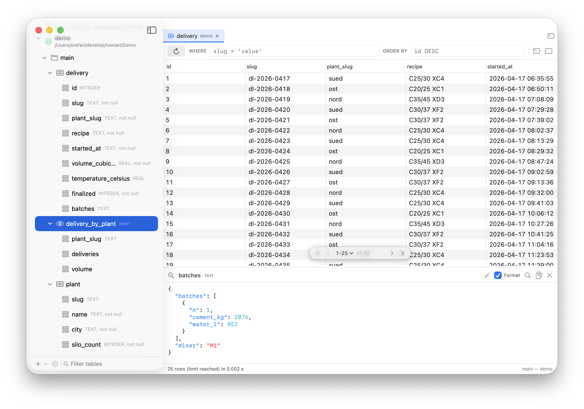

# Rowset

A macOS database browser for Postgres and SQLite, with AWS IAM sign-in.

Pick a saved connection, read a table, filter and sort it, change a value, and run SQL. Rowset
signs in to an RDS instance with an IAM token that it fetches at every connect, to any other
Postgres server with a user and a password, or to a SQLite file on this machine.



## What it does

- Saves connections as bookmarks. The bookmark file holds no secret.
- Signs in with AWS IAM or with a user and a password, and opens a SQLite file with neither.
- Shows schemas, tables, views, and columns in a tree on the left.
- Opens a table in a tab, with a `WHERE` field, sortable columns, and pages.
- Shows the whole value of a cell in a pane under the grid. It formats JSON and colours it.
- Copies a value, a column name, or a block of cells, in the formats a spreadsheet reads.
- Changes a value and sends the edits together, after it shows you the SQL.
- Runs SQL in a console, one statement at a time or all of them.

Both drivers sit behind one protocol, so every part above them reads rows the same way.

## Install

Download the DMG from the [latest release](../../releases/latest) and drag Rowset to
`/Applications`.

The app is not signed. On the first launch, right click it and pick **Open**, then confirm.

## Requirements

- macOS 14.4 or later.
- For AWS IAM: the AWS CLI version 2 and a working SSO profile in `~/.aws/config`.

## Add a connection

1. Press the `+` button under the sidebar.
2. Pick the kind: **Postgres** or **SQLite**.
3. For SQLite, press **Choose…** and pick the database file. That is all it needs.
4. For Postgres, fill in the host, the port, the database, and the database user, then pick the
   sign-in method. Rowset reads the AWS profile names from `~/.aws/config`.
5. Press **Test Connection**, then **Save**.

The database user is the IAM database user, for example `cube_testing_iam_owner`. It is not your
AWS user name.

## Signing in

**AWS IAM.** Rowset never signs a request itself. At every connect it runs
`aws rds generate-db-auth-token`, and the AWS CLI handles the SSO token cache, the refresh, and
any role chaining. The token it returns is the connection password, and it lasts 15 minutes. If
the SSO session expired, Rowset shows a sheet with the login command and a button that runs it.

**A user and a password.** The password goes into your login keychain under the id of the
bookmark, and it leaves when you delete the bookmark. Pick this for a server that has no IAM.

RDS IAM needs an encrypted connection. Each bookmark picks **verify-full**, which checks the
server against the bundled AWS RDS root store, **require**, which encrypts without checking the
server, or **disable**.

**SQLite** signs in to nothing. Rowset opens the file for reading and writing through the SQLite
that macOS ships, and waits up to three seconds when another program holds it. The tree shows one
schema, `main`, and every value comes back whole: a file on this machine is never worth leaving
behind.

## Table view

The first 50 rows are shown by default (change the page size in the floating pagination
widget). A details view also shows longer values in a multiline view. Sorting and filtering can
be set in the tool bar. Clicking the column headers also allows to change sorting by this
column.

## Keys

| Key | What it does |
| --- | --- |
| Arrows, or `h` `j` `k` `l` | move the picked cell. Shift grows the block |
| Return | change the picked cell |
| Shift-Return | open the value pane on it |
| Space | read the whole row |
| Delete | set the picked cells to NULL |
| Command-C | copy the block |
| Command-R | fetch the page again |
| Command-F | the sidebar filter, while the keyboard is in the sidebar |
| Command-T | a new console |
| Command-Return | run the statement the caret is in |
| Shift-Command-Return | run every statement, one after the other |
| Command-W | close the tab |
| Control-Tab | the next tab |
| Control-Command-S | show or hide the sidebar |

## The console

A console can be opened for each connection and allows manual SQL input. Each connection keeps
its own list of persisted consoles which can be changed between using the drop down in the tool
bar. A console takes its name from its first line, so there is no rename. Multiple statements
can be written and run independently.

## Large values

A column of JSON documents or arrays is what makes a wide table slow to open. Only the size of such
a column is retrieved and only the other values are read that are small enough.
A value not fetched yet shows a grey placeholder showing the value's size, such as `9.6 kB`. It
will be fetched full when clicking the row.

## Changing a value

Double click a cell, or press Return on it. Change as many cells as you like, then press
**Submit** in the toolbar. The statements share one transaction, and any statement that does
not match exactly one row rolls the whole batch back.

A table without a primary key cannot be edited, because an UPDATE needs a WHERE that finds one
row.

## Where the settings live

| Item | Location |
| --- | --- |
| Bookmarks | `~/Library/Application Support/Rowset/bookmarks.json` |
| Session | `~/Library/Application Support/Rowset/session.json` |
| Saved consoles | `~/Library/Application Support/Rowset/consoles.json` |
| Passwords | The login keychain, service `tech.alcemy.Rowset` |
| Window frame | `UserDefaults` for `tech.alcemy.Rowset` |

The bookmark file is plain JSON. You can edit it by hand and copy it to another machine.

## The demo database

`Demo/demo.sqlite` holds the deliveries of three concrete plants, which is what the screenshot
shows. Open it as a SQLite connection to try the app without a server of your own.

```sh
./Scripts/make-demo-db.sh    # writes it again
./Scripts/make-screenshot.sh # opens it and takes the screenshot above
```

The screenshot script opens the demo in a profile of its own, through `ROWSET_SUPPORT_DIR`, so it
never touches the connections you work with.

## Build

```sh
./Scripts/bootstrap.sh
open Rowset.xcodeproj
```

The script installs XcodeGen if it is missing, downloads the RDS certificate bundle if it is
missing, and writes the Xcode project. `Rowset.xcodeproj` is not in git, and `project.yml`
describes it.

To build the app itself:

```sh
./Scripts/build-release.sh            # writes ./Rowset.app
./Scripts/build-release.sh --install  # writes it and copies it to /Applications
```

A tag that starts with `v` builds a release. The workflow in `.github/workflows/release.yml`
generates the project, runs the tests, builds, and attaches a DMG to the release. The version in
the About window comes from `MARKETING_VERSION` in `project.yml`, so raise that before you tag.

The app icon is drawn in code. Run `./Scripts/make-icon.sh` after a change to it. The icns is
committed, so a normal build needs no extra step.

## Test

```sh
xcodebuild -project Rowset.xcodeproj -scheme Rowset -destination 'platform=macOS' test
```

The unit tests need no database.

### Live tests

`LiveConnectionTests` talks to a real database, and skips itself when the environment does not
describe one:

```sh
ROWSET_LIVE_HOST=name.eu-central-1.rds.amazonaws.com \
ROWSET_LIVE_DB=cube_testing \
ROWSET_LIVE_USER=cube_testing_iam_owner \
ROWSET_LIVE_PROFILE=AlcemyElevatedAccess-211125624762 \
./Scripts/live-test.sh
```

Name a table as well, and two more suites run on it. `MeasureTests` times the shapes of the page
query, and `LiveGridTests` opens the table through the app itself:

```sh
ROWSET_MEASURE_TABLE=truck_data ROWSET_MEASURE_LIMIT=50 ./Scripts/live-test.sh
```
